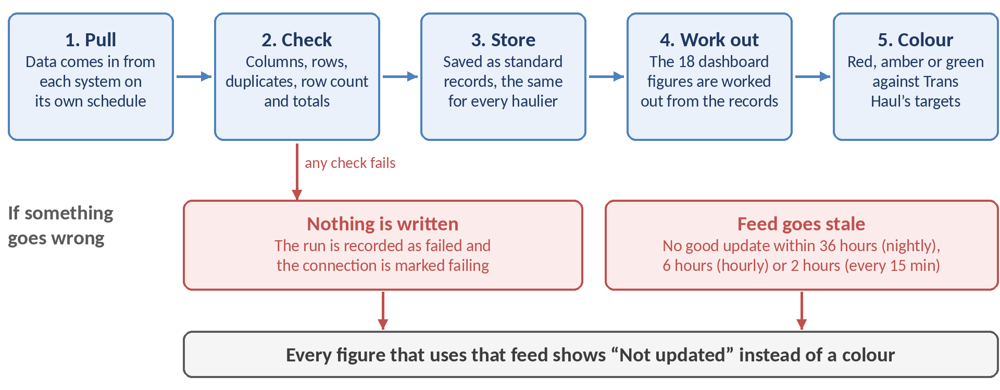

# 1. Overview: from Trans Haul's systems to the dashboard

Clearpath reads data from nine of Trans Haul's systems. It only reads: it never changes anything in Vigo, Xero or any other system. All data follows the same five steps before it reaches the dashboard.

{width=100%}

1. **Pull.** Each connection collects data automatically, on its own schedule: through the supplier's API (a direct link between two computer systems) using a key, or through a read-only sign-in that Trans Haul approves. Systems without an API use one of two automatic routes: a file saved into a named SharePoint folder, or a report the supplier emails to Clearpath's report inbox. Nobody uploads anything by hand day to day.
2. **Check.** Before anything is saved, Clearpath checks the data against the source (section 4).
3. **Store.** The data is saved as standard records, such as jobs, defects, staff and incidents. These are the same for every haulier.
4. **Work out.** The 18 dashboard figures are worked out from the records, for the whole company and for each division.
5. **Colour.** Each figure is compared with Trans Haul's targets: green "On target", amber "Watch" or red "Action needed". A figure with no data shows grey "Waiting for data", never green.

**When a feed fails or goes stale.** If any check fails, nothing is written. The run is recorded as failed and the connection is marked "failing". Every figure that uses that feed then shows "Not updated" instead of a colour. The same happens if a feed has not had a good update within its allowed age, which follows its schedule: 2 hours for every 15 minutes, 6 hours for hourly, 36 hours for nightly, 8 days for weekly and 35 days for monthly. The figures are trusted again after the next successful run.

# 2. The nine connections

"How it connects" is the preferred way; section 3 gives the fallbacks. All nine are automatic: six through an API or an approved sign-in, three through a SharePoint folder. "No" in the last column means the details come from public information only.

| System and supplier | How it connects | What it brings in | Dashboard figures it feeds | How often | Status | Confirmed with supplier |
|:------------------|:--------------|:----------------|:---------------------|:---------|:----------|:------------|
| **Vigo** (transport management). Vigo Software (Kerridge / Klipboard) | Supplier's API with a key, if offered | Customers, jobs, job costs | Service: On time in full, On time. Cost: Revenue against plan, Job cost against plan | Every 15 minutes | Waiting for access | No |
| **Tachomaster** (drivers' hours). Road Tech | Supplier's API with a key, if offered | Drivers' hours infringements; working time events | Compliance: Infringements. People: all four figures | Nightly | Waiting for access | No |
| **Falcon Tracking** (DOT Tracking). Road Tech | Supplier's API with a key, on request | Jobs: mileage, arrival times, idling | Service: On time in full, On time. Cost: Revenue against plan, Job cost against plan | Hourly | Waiting for access | No |
| **PreDrive** (walkaround checks and defects). Road Tech | Supplier's API with a key, if offered | Vehicle defects; compliance due dates | Compliance: Open vehicle defects, Overdue items, Due in the next 14 days | Hourly | Waiting for access | No |
| **Xero** (accounts). Xero | Trans Haul approves a read-only sign-in | Profit and loss; daily costs; revenue plan, if a Xero budget | Cost: Warehouse cost per case; Revenue against plan, if a Xero budget | Nightly | Waiting for access | Yes |
| **SharePoint** (Microsoft 365). Microsoft | Trans Haul approves a read-only sign-in | Staff list; holiday, absence and overtime; incidents; compliance due dates; disciplinary and grievance cases | Health and Safety: all three figures. People: all four figures. Compliance: Overdue items, Due in the next 14 days | Nightly | Waiting for access | Yes |
| **BrightPay** (payroll). BrightPay | SharePoint folder (automatic) | Payroll periods; hours, overtime and absence | People: all four figures | Monthly | Waiting for access | No |
| **Bibby** (invoice finance). Bibby Financial Services | SharePoint folder (automatic) | Monthly statement (amount drawn), for the cash view add-on | None of the 18 | Monthly | Waiting for access | No |
| **Warehouse figures**. Supplier to confirm with the Warehouse Manager | SharePoint folder (automatic) | Daily cases, picks, units and labour hours; daily costs | Service: Picks per labour hour, Cases per labour hour. Cost: Warehouse cost per case | Nightly | Waiting for access | No |

## The 18 dashboard figures and where they come from

If any connection listed against a figure is failing or stale, that figure shows "Not updated".

| Quadrant | Figure | Comes from |
|:----------------------|:-----------------------------------------|:-------------------------------------------|
| Health and Safety (centre) | Accidents this month | SharePoint |
| | Open near misses | SharePoint |
| | Days since last accident | SharePoint |
| Service | On time in full | Vigo, Falcon |
| | On time | Vigo, Falcon |
| | Picks per labour hour | Warehouse figures |
| | Cases per labour hour (work rate) | Warehouse figures |
| Cost | Revenue against plan | Vigo, Falcon, plus Trans Haul's monthly revenue plan (from a Xero budget, or entered in Targets) |
| | Job cost against plan | Vigo, Falcon |
| | Warehouse cost per case | Xero, Warehouse figures |
| People | Absence | SharePoint, Tachomaster, BrightPay |
| | On holiday | SharePoint, Tachomaster, BrightPay |
| | Overtime (last 7 days) | SharePoint, Tachomaster, BrightPay |
| | Working time breaches (last 7 days) | SharePoint, Tachomaster, BrightPay |
| Compliance | Infringements (last 7 days) | Tachomaster |
| | Overdue items | SharePoint, PreDrive |
| | Due in the next 14 days | SharePoint, PreDrive |
| | Open vehicle defects | PreDrive |

# 3. What's needed to switch on each connection

## What we need from Trans Haul

1. **Microsoft approval.** Trans Haul's Microsoft admin approves read-only access to the named SharePoint sites. This one approval covers both the SharePoint connection and the SharePoint folders.
2. **Xero approval.** Trans Haul's Xero admin approves read-only access once.
3. **Folder names.** The SharePoint folders for the BrightPay payroll export, the Bibby statement and the warehouse spreadsheet.
4. **Payroll export.** Who runs the monthly BrightPay export, so it is saved into the payroll folder as part of each pay run.
5. **Warehouse figures.** Where the warehouse figures live, from the Warehouse Manager.

## Points that apply to every connection

- **Keys go to Sam only.** Any key or password a supplier issues goes into the Supabase secrets vault on clearpath-production. Sam enters it himself. It is never put in code, in the database or in an email.
- **A real sample comes first.** Seven of the nine connections are based on public information only. None of them goes live until a real sample from Trans Haul has been mapped and checked.
- **Nobody uploads anything day to day.** Six connections are automatic through an API or an approved sign-in, and three through a SharePoint folder. The admin console can still load a file by hand, but only for past history or in an emergency.
- **Some parts are not built yet.** The server functions that will run the scheduled API pulls, read the report inbox and handle the Xero and Microsoft sign-in approvals are not built yet. The SharePoint folder pick-up is built and tested but not yet switched on.

## How the SharePoint folder pick-up works

For a system with no API, someone saves a file into a named SharePoint folder as part of their normal routine, such as the monthly pay run. Clearpath then does the rest:

- it reads the folder through Microsoft's own connection, read-only, and only on the sites Trans Haul's Microsoft admin has approved;
- it reads only files that have changed since its last good run;
- it reads CSV files, and reads Excel sheets directly from the workbook, so nobody has to export anything;
- it keeps an untouched copy of each file with its fingerprint, runs the same checks as every other connection, writes the records and recalculates the figures;
- if a file fails a check (for example, a renamed column), nothing is written, the connection shows as failing and the copy is kept so the problem can be seen.

It needs no extra approval: the Microsoft approval for the SharePoint connection covers it. It is planned to run hourly. It goes live with web hosting, once Microsoft access is approved.

The other automatic route for a system without an API is the report inbox: the supplier emails a scheduled report to Clearpath. The report inbox is not built yet.

## System by system

**Vigo (transport management).** Vigo has no public API documentation.

- *Needed:* if Vigo offers an API, read-only API documentation and a key for Trans Haul's data, from Vigo Software.
- *Fallback:* a scheduled daily jobs export (a CSV file) that Vigo emails to the report inbox.
- *Before it goes live:* the column names in our mapping are placeholders until a real export arrives.

**Tachomaster, Falcon and PreDrive (Road Tech).** All three come from Road Tech Computer Systems. No public API was found for Tachomaster. Road Tech runs integrations for partners, so we ask once for all three together.

- **Tachomaster.** *Needed:* API access and a key from Road Tech, if it offers them. *Fallback:* Tachomaster can email scheduled reports to the report inbox.
- **Falcon.** Brings in mileage, arrival times and idling. *Needed:* API access from Road Tech, which offers it on request. *Fallback:* Falcon supports scheduled daily reports by email, to the report inbox.
- **PreDrive.** Road Tech describes it as DVSA compliant. We read the results; we do not rebuild walkaround checks. *Needed:* API access and a key from Road Tech, if it offers them. *Fallback:* a scheduled emailed report, to the report inbox.

**Xero (accounts).** Confirmed: Xero has a public API.

- *Needed:* Trans Haul's Xero admin approves read-only access once.
- *Revenue plan:* if Trans Haul keeps its monthly revenue plan as a Xero budget, it comes through this connection. If not, a director or the consultant enters it in Users and settings, under Targets.
- *Also check:* Xero has charged developers in pricing tiers since March 2026. Check the cost per connected company.

**SharePoint (Microsoft 365).** Confirmed: Clearpath uses Microsoft's own connection (Microsoft Graph) with a permission called "Sites.Selected". This gives access to named SharePoint sites only, not the whole of Trans Haul's Microsoft 365.

- *Needed:* Trans Haul's Microsoft admin approves access to the named sites.
- *Keep in mind:* the spreadsheet layouts must stay the same. If a column is renamed, the column check fails and the figures show "Not updated".

**BrightPay (payroll), by SharePoint folder.** BrightPay has no general API. It only links payroll journals to accounting packages such as Xero.

- *Payroll cost* reaches Clearpath automatically through the Xero connection.
- *Hours, overtime and absence:* the monthly export is saved into a SharePoint folder as part of the pay run and picked up automatically.
- *How often:* monthly, so People figures stay trusted for up to 35 days between exports.

**Bibby (invoice finance), by SharePoint folder.** No public API was found. Bibby works through its Client Online portal.

- *Debtor ageing* comes from Xero automatically.
- *The monthly statement* (the amount drawn) is saved into a SharePoint folder, or emailed to the report inbox, and picked up automatically.
- Bibby feeds the cash view add-on only, not the 18 dashboard figures.

**Warehouse figures, by SharePoint folder.** The source is still to be confirmed with the Warehouse Manager.

- *If the figures are in a spreadsheet in SharePoint,* Clearpath reads it directly. No export is needed. It must follow Clearpath's warehouse layout (date, cases, picks, units, labour hours), with daily costs for cost per case.
- *If they are in a warehouse system,* Clearpath would use its API or a scheduled emailed report.

# 4. Security

## Read-only access

Every connection is read-only. Clearpath never changes anything in Vigo, Xero or any other system. Xero access is approved by Trans Haul's Xero admin. SharePoint access covers only the sites Trans Haul's Microsoft admin approves.

## Actions stay inside Clearpath

Anyone who can see an area can raise an action there, against a red or amber figure, an incident, a compliance item, a defect or an infringement. Each action has an owner, who must be able to see that area, a priority and a follow-up date. Progress, completion and reopening are recorded in the action's timeline and in the activity log. Actions are held in Clearpath only. Nothing is ever written back to Vigo, Xero or any other system.

## Keys and passwords

- Supplier keys and passwords go only in the Supabase secrets vault on clearpath-production. Sam enters them himself.
- They are never put in code, in the database or in an email.
- A connection record holds only the name of its secret, never the key itself.
- If anyone tries to save a connection whose settings contain a key, password, secret or token, Clearpath refuses it.
- Only the platform admin (Sam) can set up or change a connection.

## Checks before anything is trusted

Every file or report passes these checks before a single record is written. If any one fails, nothing is written and the connection is marked "failing".

| Check | What it catches |
|:-------------------------|:------------------------------------------------------------|
| Columns present | A column we rely on has been renamed or removed. This is the most common way a feed breaks. |
| Rows readable | A row that cannot be read. Dates are read the UK way (day, month, year). Times are adjusted correctly for GMT and BST. Amounts in £ are read with commas and bracketed negatives. Each problem is reported by row number and column, as it appears in Excel. |
| No duplicates | The same reference appearing twice. |
| Row count | Fewer or more rows than the source says it sent, when the source states a count. |
| Totals | Our totals differ from the source's own totals by even a penny, when the source gives totals (for example, a report footer). |

## Activity log

Setting up or changing a connection is written to the activity log: who did it, their role, what changed and when. The log also records each stored file, changes to access levels, targets and the revenue plan, and every step of an action. Sam and Trans Haul's directors can see it.

## What is kept from each pull

Every run of every connection leaves a record, whether it worked or not:

- when it started and finished;
- the result: worked, failed, or a check did not match;
- how many rows came in and how many were written;
- each check, with what was expected, what was found and whether it passed;
- the error message, if there was one;
- where the untouched copy of the file is kept (see below).

**Untouched copies.** Every file Clearpath picks up or loads is stored exactly as it was received. With it goes a fingerprint: a code the database works out from the file's exact contents. So any figure can be traced back to the exact file it came from. Only Sam can read the stored copies. Once the API connections are built, each reply from a supplier will be kept the same way.

When the report inbox is built, each email it receives will be logged too: who sent it, the subject, the attachments, and which run processed it. Only Sam can see that log.

Sam and Trans Haul's directors can see the connections and their run records. By default no other role can.

# 5. What's built and what's next

**Where things stand.** Live data is held in a Supabase project called clearpath-production, in the London region, in Your AI Ltd's Supabase account. Trans Haul was added there on 17 November 2026, with all nine connections recorded as "waiting for access". On 18 November the BrightPay, Bibby and warehouse connections were changed to SharePoint folder. No supplier keys are stored yet and no data has been pulled yet.

This is the project's own status list, including the changes made on 18 November 2026.

| Part | Status |
|:--------------------------------------------------------|:-------------------------------------|
| Companies, roles, access levels, two-factor sign-in, activity log | Built and tested |
| Standard records for all eight Trans Haul systems plus the warehouse | Built and tested |
| The 18 figures, targets, red, amber and green, dashboard data | Built and tested |
| Connections: setup, run records, failing feeds marked "Not updated", keys refused in settings | Built and tested |
| How old each feed may be, by schedule (every 15 minutes to monthly), and the admin health list using the same rule | Built and tested |
| Actions: raise, own, progress, complete and reopen, with a timeline | Built and tested |
| Revenue plan: entered in Targets, or from a Xero budget | Built and tested |
| Comments; policy library (master and company documents, read and sign) | Built and tested |
| Connection engine: reading files and reports, UK dates and times, mapping, checks | Built and tested |
| Screens: sign-in with two-factor, invitations and password reset, dashboard, the five quadrant pages, links, records, comments, my account | Built and tested in a browser |
| Users and settings for directors: users and invitations, access levels, targets, connections, documents, activity | Built and tested in a browser |
| Admin console: companies, connections, file import with checks, master library, health | Built and tested in a browser |
| SharePoint folder pick-up: CSV files and Excel sheets, checked, stored untouched and imported, figures recalculated | Built and tested; not yet deployed or scheduled (goes live with hosting and Microsoft approval, planned hourly) |
| Loading a file by hand, for past history or an emergency: every kind of record except disciplinary and grievance cases, with an untouched copy kept | Built and tested |
| Invitation email function | On clearpath-production; switched off until the web address is set |
| Real connections to each supplier | Waiting for access and sample files |
| Other server functions: report inbox, nightly schedule, daily and weekly emails, Xero, Microsoft | Not started (versions from the November demo to adapt) |
| Uploading document files (PDFs) to the library | Switched on with hosting (file storage) |
| Supabase project clearpath-production (London, Your AI Ltd account) | Set up 17 November 2026. Trans Haul added, with all nine connections waiting for access; three changed to SharePoint folder on 18 November |
| Web hosting and email | Not set up |

## Next steps for the connections

1. **Access.** API access and keys from Vigo and Road Tech if they offer them, or their scheduled reports if not; Trans Haul's Xero admin and Microsoft admin approve read-only access; the SharePoint folder names; who runs the BrightPay export; the Warehouse Manager confirms where the warehouse figures are kept.
2. **Keys stored.** Sam puts each key in the secrets vault as it arrives.
3. **Build.** The server functions for the scheduled pulls, the report inbox and the Xero and Microsoft sign-in approvals.
4. **Samples.** Map and check a real sample from each system before it goes live.

## Still open before go-live

- **SharePoint folder pick-up.** Deploy and schedule it with web hosting. Trans Haul to name the folders.
- **Other server functions.** The scheduled API pulls, the report inbox and the Xero and Microsoft sign-in approvals are not built yet. Until they are, no data flows automatically.
- **Web hosting and email.** Not set up yet.
